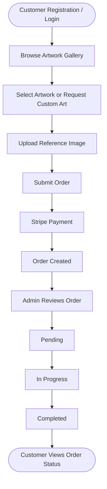
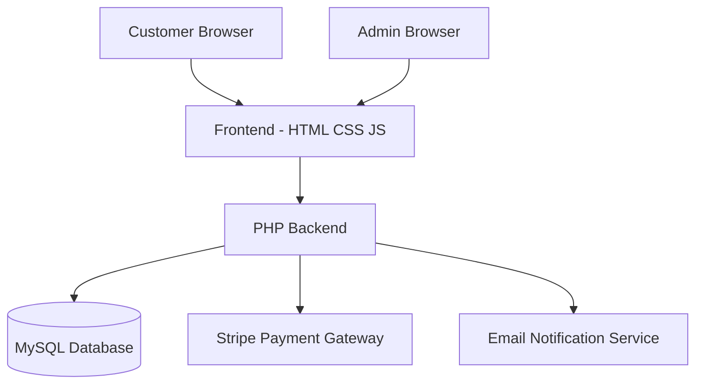
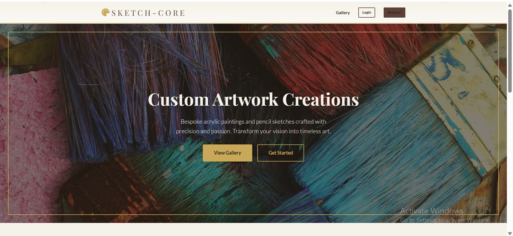
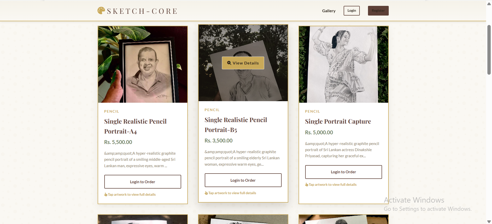
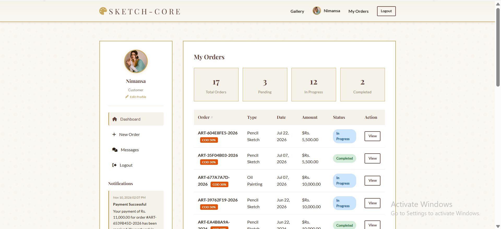
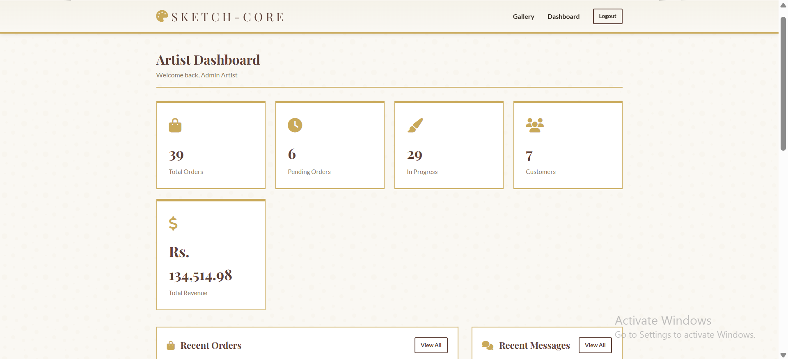
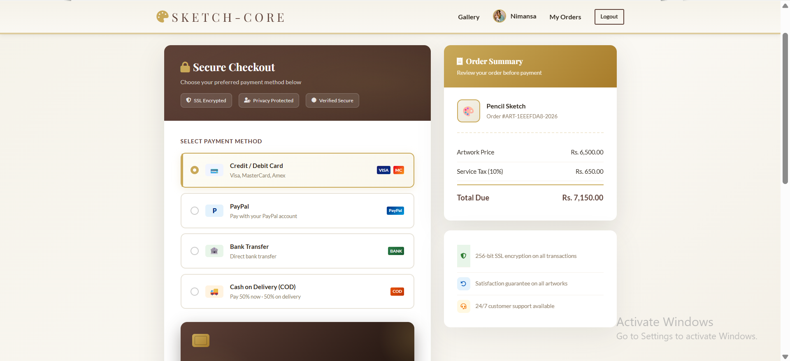

# 🎨 SKETCH-CORE
### Custom Art Ordering System with Automated Workflow Management

<p align="center">

  **A Web-Based Platform for Custom Acrylic Paintings & Realistic Pencil Sketches**

  <br>

  A complete digital solution designed to simplify custom artwork ordering, payment processing, customer communication, and order workflow management.

</p>

---

## 📌 Table of Contents

- [Project Overview](#-project-overview)
- [Project Objectives](#-project-objectives)
- [System Features](#-system-features)
- [User Roles](#-user-roles)
- [Order Workflow](#-order-workflow)
- [Technology Stack](#-technology-stack)
- [System Architecture](#-system-architecture)
- [Database Design](#-database-design)
- [Project Structure](#-project-structure)
- [Installation Guide](#-installation-guide)
- [Configuration](#-configuration)
- [Security Considerations](#-security-considerations)
- [Screenshots](#-screenshots)
- [Future Enhancements](#-future-enhancements)
- [Author](#-author)

---

## 📖 Project Overview

**SKETCH-CORE** is a web-based Custom Art Ordering System developed to digitize and automate the process of ordering personalized artwork.

The platform provides customers with an online environment where they can explore available artwork, request custom acrylic paintings and realistic pencil sketches, upload reference images, place orders, and make online payments.

The system also provides an administrative dashboard that enables the artist to manage customer accounts, artwork, orders, payments, and customer communications through a centralized platform.

By introducing an automated workflow management process, SKETCH-CORE aims to reduce manual work, improve order tracking, and enhance communication between customers and the artist.

---

## 🎯 Project Objectives

- Develop an online platform for custom artwork ordering.
- Simplify the artwork selection and ordering process.
- Enable customers to upload reference images for personalized artwork.
- Integrate secure online payment processing through Stripe.
- Automate order status management and tracking.
- Improve communication between customers and the artist.
- Provide centralized administration and order management.
- Enhance the overall customer experience.

---

## ✨ System Features

### 👤 Customer Module

| Feature | Description |
|---|---|
| User Registration | Create a customer account. |
| Authentication | Secure customer login and logout. |
| Artwork Gallery | Explore available pencil sketches and acrylic paintings. |
| Artwork Details | View artwork information and pricing. |
| Custom Art Orders | Request personalized artwork. |
| Image Upload | Upload reference images for custom orders. |
| Online Payments | Process payments using Stripe. |
| Order Tracking | Track order progress and status. |
| Messaging | Communicate directly with the artist. |
| Email Notifications | Receive order-related email updates. |

### 🔐 Admin Module

| Feature | Description |
|---|---|
| Admin Authentication | Secure administrator access. |
| Dashboard | View system statistics and order summaries. |
| Customer Management | Manage registered customer accounts. |
| Artwork Management | Add, update, and manage artwork. |
| Order Management | View and manage customer orders. |
| Status Management | Update order processing status. |
| Payment Management | Monitor payment information. |
| Messaging Management | Communicate with customers. |
| Workflow Management | Manage the order processing lifecycle. |

---

## 👥 User Roles

The system consists of two main user roles.

**1. Customer**

Customers can register, log in, explore artwork, submit custom art requests, upload reference images, make payments, track orders, and communicate with the artist.

**2. Administrator**

The administrator manages customers, artwork, incoming orders, payments, order progress, and customer communication through the admin dashboard.

---

## 🔄 Order Workflow

The system follows a structured order management workflow.



**Order Status Lifecycle**

- **Pending:** Order has been submitted and is awaiting processing.
- **In Progress:** Artwork creation or order processing has started.
- **Completed:** The artwork order has been completed.

---

## 🛠️ Technology Stack

| Technology | Purpose |
|---|---|
| HTML5 | Web page structure |
| CSS3 | Styling and responsive layouts |
| JavaScript | Client-side interactions |
| Bootstrap | Responsive UI components |
| PHP | Server-side application logic |
| MySQL | Relational database management |
| Stripe | Online payment integration |
| PHPMailer | Email notifications, if configured |
| Composer | PHP dependency management |
| Apache | Web server |
| XAMPP | Local development environment |
| Visual Studio Code | Development environment |
| Git & GitHub | Version control and source code management |

---

## 🏗️ System Architecture

SKETCH-CORE follows a client-server architecture.



### Architecture Components

- **Presentation Layer:** Provides the user interface for customers and administrators.
- **Application Layer:** Handles authentication, business logic, order processing, and payment operations.
- **Database Layer:** Stores customer, artwork, order, and payment-related information.
- **External Services:** Supports payment processing and email communication.

---

## 🗄️ Database Design

The application uses MySQL as its relational database management system.

The database stores information related to:

- Customer accounts
- Administrator accounts
- Artwork details
- Custom art requests
- Customer orders
- Payment information
- Customer messages
- Order status history (if implemented)

**Database Name:** `art_ordering_system`

**SQL File:** `database/database.sql`

---

## 📁 Project Structure

The following is an illustrative project structure. Adjust it to match the actual folders and files in your repository.

```text
art-ordering-system/
│
├── admin/
│   ├── dashboard.php
│   ├── customers.php
│   └── artworks.php
    └── add_artwork.php
    └── edit_artwork.php
    └── messages.php
    └── orders.php
    └── update_status.php
    └── view_order.php

│
├── customer/
│   ├── dashboard.php
│   ├── create_payment_intent.php
│   └── checkout.php
    └── delivery_details.php
    └── messages.php
    └── order_detail.php
    └── payment.php
    └── payment_success.php
    └── place_order.php
    └── process_payment.php
    └── profile.php
│
├── assets/
│   ├── css/
│   ├── js/
│   
│
├── config/
│   └── database.php
│
├── database/
│   └── database.sql
│
├── includes/
    ├── footer.php
    ├── header.php
    ├── config.php
│
├── index.php
├── login.php
├── register.php
├── logout.php
│
├── PHPMailer
     ├── Exception.php
     ├── PHPMailer.php
     ├── SMTP.php
│
│
│├── gallery.php
│├── test_email.php
│
├── README.md
└── .gitignore
```

---

## ⚙️ Installation Guide

Follow these steps to set up the project locally.

### Prerequisites

Make sure the following software is installed:

- PHP 7.4 or above
- MySQL 5.7 or above
- Apache Web Server
- Composer
- XAMPP / WAMP / MAMP
- Git
- Web Browser

### Step 1: Clone the Repository

Open your terminal and execute:

```bash
git clone https://github.com/dulaniweerasinghe/custom-art-ordering-system.git
```

Navigate to the project directory: 

```bash
cd art-ordering-system
```

### Step 2: Move the Project

Place the project inside your XAMPP `htdocs` directory.

Example:

```text
C:\xampp\htdocs\art-ordering-system
```

### Step 3: Start Apache and MySQL

1. Open XAMPP Control Panel.
2. Start Apache.
3. Start MySQL.

### Step 4: Create the Database

1. Open phpMyAdmin.
2. Create a database named:

```sql
art_ordering_system
```

3. Select the created database.
4. Import the SQL file:

```text
database/database.sql
```

### Step 5: Install PHP Dependencies

Open the project directory in VS Code Terminal.

Execute:

```bash
composer install
```

This installs the dependencies defined in `composer.json`, including the Stripe PHP SDK if configured there.

### Step 6: Configure the Database

Update the database connection settings using your local database credentials.

### Step 7: Run the Application

Open your browser and navigate to:

```text
http://localhost/art-ordering-system/
```

The application should now be accessible locally.

---

## 🔧 Configuration

### Database Configuration

Configure the database connection with the following local settings as applicable:

| Setting | Example |
|---|---|
| Database Host | localhost |
| Database Name | art_ordering_system |
| Database Username | root |
| Database Password | Your local MySQL password |

Use the actual database configuration file included in the project.

### Stripe Configuration

The application uses Stripe for payment processing.

1. Create a Stripe account.
2. Obtain your test API keys from the Stripe Dashboard.
3. Configure the keys using environment variables or a secure configuration file.
4. Test payment functionality using Stripe test mode.

**Important:** Never expose Stripe secret keys in a public GitHub repository.

---

## 🔒 Security Considerations

The project should follow these security practices:

- Use password hashing for stored user passwords.
- Validate and sanitize user inputs.
- Use prepared SQL statements to prevent SQL injection.
- Restrict access to administrator-only pages.
- Validate uploaded image file types and sizes.
- Protect sensitive configuration files.
- Never commit API keys, passwords, or private credentials.
- Use HTTPS in production environments.
- Verify payment status on the server side.

---

## 🖼️ Screenshots

Screenshots of the application can be added here to demonstrate the user interface and system functionality.

### Home Page



### Artwork Gallery



### Customer Dashboard



### Admin Dashboard



### Payment Method



---

## 🚀 Future Enhancements

Potential improvements for future versions include:

- Advanced order analytics and reporting.
- Enhanced customer order tracking.
- Improved artwork recommendation features.
- Additional online payment methods.
- Advanced notification management.
- Improved mobile user experience.
- Customer feedback and review management.

---

## 🧪 Testing

The following areas can be tested during system verification:

- Customer registration and authentication.
- Artwork browsing and selection.
- Custom order submission.
- Reference image uploads.
- Payment processing.
- Order status updates.
- Customer-admin messaging.
- Email notification delivery.
- Role-based access restrictions.

---

## 👩‍💻 Author

**Dulani Weerasinghe**

Information Technology Student | Software Development Enthusiast

**Project:** Custom Art Ordering System with Automated Workflow Management

**Technologies:** PHP | MySQL | HTML | CSS | JavaScript

- GitHub:   https://github.com/dulaniweerasinghe
- LinkedIn: https://www.linkedin.com/in/dulani-weerasinghe-649330311
---

## 📄 License

This project was developed as an academic software development project.

Add an appropriate open-source license before permitting reuse or redistribution.

---

<p align="center">

  **SKETCH-CORE – Bringing Creativity and Technology Together.** 🎨

</p>